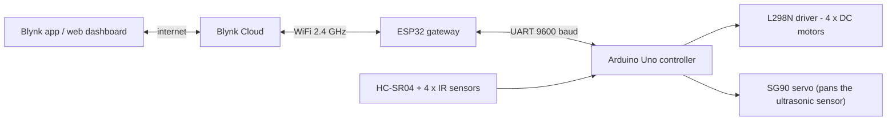

# 4-in-1 Autonomous Robot Car with IoT Control

One hand-built robot car, four autonomous behaviours, controlled from your phone.
An **Arduino Uno** runs the robot in real time, an **ESP32** connects it to the **Blynk** cloud, and a dashboard lets you
switch the robot ON/OFF, change its mode on the fly (no re-upload) and watch the live distance reading.

> Developed for *BITE403L - Embedded Systems & IoT* (VIT).

## Features

- **Four autonomous modes**, selectable at run time from the Blynk dashboard
- **Remote ON / OFF** - the robot boots OFF, and an OFF command stops it immediately, even in the middle of a manoeuvre
- **Live telemetry** - front distance from the ultrasonic sensor is shown on a gauge
- **Two-node design** - the Uno keeps hard real-time control, the ESP32 handles WiFi and the cloud, so network latency never stalls obstacle avoidance
- Smooth servo scanning, median-filtered ultrasonic readings, 4 x DC motors driven in left/right pairs

## Modes

| # | Mode | Sensors | What it does |
|---|------|---------|--------------|
| 1 | **Obstacle avoiding** | HC-SR04 + servo | Drives forward. When an obstacle is closer than 40 cm it stops, backs off, scans left and right with the servo, turns toward the clearer side and continues. |
| 2 | **Line follower** | 2 bottom IR | Tracks a black line: straight when both sensors are off the line, turns toward the sensor that sees it, stops when both see it. |
| 3 | **Line follower + obstacle avoiding** | 2 bottom IR + HC-SR04 + servo | Follows the line; if an object is within 20 cm it scans, side-steps it and rejoins the line. |
| 4 | **Object following** | 2 top IR + HC-SR04 | The IR pair gives the left/right bearing of a hand or object, the ultrasonic sensor keeps it 10-30 cm away; stops if it is too close or too far. |

The default mode after boot is **1 (obstacle avoiding)**, but the robot stays OFF until you switch it on.

## System architecture



Control flows left to right (dashboard -> robot), telemetry flows back (distance -> gauge).

### Serial protocol (ESP32 <-> Uno)

Plain ASCII, 9600 baud, newline-terminated.

| Message | Direction | Meaning |
|---------|-----------|---------|
| `E1` / `E0` | ESP32 -> Uno | Robot ON / OFF |
| `M1` ... `M4` | ESP32 -> Uno | Select mode 1-4 |
| `D<cm>` (e.g. `D125`) | Uno -> ESP32 | Front distance in cm (0 = no echo), about once per second |

The ESP32 sends each command four times so that a byte dropped by the Uno's SoftwareSerial still gets through.

## Hardware

| Part | Qty | Purpose |
|------|-----|---------|
| Arduino Uno (ATmega328P) | 1 | Real-time controller |
| ESP32 DevKit (WROOM-32) | 1 | WiFi gateway |
| L298N dual H-bridge driver | 1 | Drives the motors; its 5 V regulator powers the Uno, sensors and servo |
| DC gear motors + wheels | 4 | Left pair + right pair (differential drive) |
| HC-SR04 ultrasonic sensor | 1 | Distance measurement |
| SG90 servo | 1 | Pans the ultrasonic sensor |
| IR sensor modules | 4 | 2 for line following (bottom), 2 for object following (top) |
| 2 x 18650 Li-ion (7.4 V) | 1 set | Main supply (L298N + motors) |
| 4 x AA (6 V) | 1 set | Separate supply for the ESP32 |
| 1 kOhm + 2 kOhm resistors | 1 each | Voltage divider for Uno TX -> ESP32 RX |

### Pin connections

**Arduino Uno**

| Pin | Connected to |
|-----|--------------|
| D2 | ESP32 GPIO17 (TX2) |
| D3 | Servo signal |
| D4 | ESP32 GPIO16 (RX2) **through the 1 k / 2 k divider** |
| D5 / D6 | L298N ENA / ENB (PWM speed) |
| D7 / D8 | L298N IN1 / IN2 (right motors) |
| D9 / D10 | L298N IN3 / IN4 (left motors) |
| D11 / D12 | HC-SR04 TRIG / ECHO |
| A0 / A1 | Bottom IR - right / left (line) |
| A2 / A3 | Top IR - left / right (object) |

**ESP32**

| Pin | Connected to |
|-----|--------------|
| GPIO17 (TX2) | Uno D2 |
| GPIO16 (RX2) | Uno D4 via divider |
| VIN | 4 x AA pack (+) |
| GND | Pack (-) and the common ground |

### Wiring notes (important)

- **Common ground:** the Uno, L298N and ESP32 grounds must all be connected, otherwise the serial link does not work.
- **ESP32 has its own supply** (4 x AA on VIN). Powering it from the L298N 5 V rail causes brown-outs and a flaky WiFi connection.
- **ENA / ENB jumpers on the L298N must be removed**, so the PWM from D5 / D6 controls the speed. Keep the 5 V-enable jumper fitted.
- **Logic levels:** the ESP32 is 3.3 V only. Uno D4 (5 V) goes through a divider: D4 -> 1 kOhm -> GPIO16, and a 2 kOhm resistor from GPIO16 to GND. ESP32 TX (3.3 V) can drive Uno D2 directly.
- IR modules output HIGH on the line (bottom pair) and LOW when they see an object (top pair); adjust the potentiometer on each module for range.

## Repository layout

```
robot_car_uno/                      Arduino Uno firmware
  robot_car_uno.ino
robot_car_esp32_gateway/            ESP32 + Blynk gateway firmware
  robot_car_esp32_gateway.ino
  arduino_secrets.example.h         template for your credentials
```

## Setup

### 1. Blynk

1. Create a free account at [blynk.cloud](https://blynk.cloud) and a **template** (hardware: ESP32, connection: WiFi).
2. Add three **datastreams** (virtual pins, Integer):

   | Pin | Name | Min | Max |
   |-----|------|-----|-----|
   | V0 | Power | 0 | 1 |
   | V1 | Mode Selector | 1 | 4 |
   | V2 | Distance | 0 | 400 (unit: cm) |

3. Build the dashboard: a **Switch** on V0, a **Segmented switch** on V1 with the values `1 Obstacle`, `2 Line`, `3 Line+Obj`, `4 Object`, and a **Gauge** on V2.
4. Create a **device** from the template and note its *Template ID*, *Template Name* and *Auth token*.

### 2. Software

- Arduino IDE 2.x
- Libraries: **NewPing** and **Blynk** (by Volodymyr Shymanskyy) - install from the Library Manager. `Servo` and `SoftwareSerial` are bundled.
- ESP32 board support: install the **"esp32 by Espressif Systems"** package (not "Arduino ESP32 Boards", which is for the Arduino Nano ESP32) and select **ESP32 Dev Module**.

### 3. Upload

1. In `robot_car_esp32_gateway/`, copy `arduino_secrets.example.h` to `arduino_secrets.h` and fill in your Blynk template ID, auth token and 2.4 GHz WiFi name/password. This file is git-ignored.
2. Upload `robot_car_esp32_gateway.ino` to the ESP32 (board: *ESP32 Dev Module*).
3. Upload `robot_car_uno.ino` to the Arduino Uno (board: *Arduino Uno*).
4. Wire the two boards as described above.

## Usage

1. Power the car. The ESP32 connects to WiFi and the device shows **Online** in Blynk.
2. Pick a mode on the Mode Selector.
3. Switch **Power ON** - the robot starts. Switch it OFF to stop it immediately.
4. The Distance gauge shows the live front distance. The Uno's on-board LED mirrors the ON/OFF state.

For the first test, lift the wheels off the ground.

## Tuning

Constants at the top of `robot_car_uno.ino` and inside each mode function:

| Constant | Effect |
|----------|--------|
| `SPEED_PERCENT` | Overall motor speed scaling (raise it if the motors only buzz) |
| `DISTANCE_TO_CHECK`, `BACK_TIME`, `TURN_TIME` | Obstacle threshold, back-off time and turn time in obstacle mode |
| `SERVO_STEP_DELAY` | Servo sweep speed (larger = slower) |
| `MIN_DISTANCE`, `MAX_DISTANCE` | Following window in object-following mode |

## Troubleshooting

| Problem | Likely cause / fix |
|---------|--------------------|
| Device stays **Offline** | The ESP32 only supports **2.4 GHz** WiFi; check the SSID / password and that a phone hotspot has not switched itself off. |
| Serial monitor says **Invalid auth token** | Re-copy the token from Blynk (watch for `1` vs `l`). |
| Dashboard works but the robot ignores ON/OFF or mode | Check the common ground and the D2 <-> GPIO17 wire; the Uno's LED should follow the switch. |
| ESP32 resets or drops offline when the motors run | Power the ESP32 from its own supply, not from the L298N 5 V rail. |
| Motors buzz but do not turn | `SPEED_PERCENT` too low, or the ENA / ENB jumpers are still fitted. |
| Distance gauge stuck at 0 | Check TRIG / ECHO wiring; 0 also means "nothing within range". |

## Credits

The four navigation behaviours are adapted from the widely shared open-source *4-in-1 Arduino robot* design. This project adds the
ESP32 / Blynk IoT layer, run-time mode switching, remote stop, telemetry and the safety and reliability improvements described above.

**Team:** Piyush Surana, Kartikey Chauhan, Akshat Amit Agarwal
